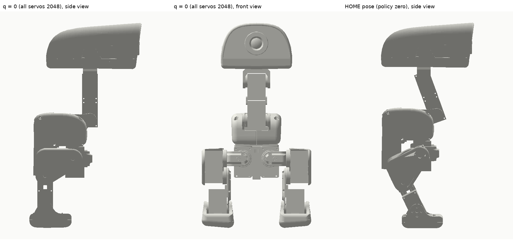

# 舵机零点姿势（q = 0，所有舵机 2048）



*左：q = 0（所有舵机 2048）侧视；中：q = 0 前视；右：HOME（策略零点）侧视。图由官方 MJCF
模型在 qpos=0 / HOME 下渲染。*

## 结论

**所有舵机零点 = 模型里所有关节角为 0 的姿势**：腿自然下垂、脚掌水平、脖子直立、头朝前
（上图左/中）。此时每颗舵机的 raw position 应为 **2048**（Feetech 0–4095，中位 2048）。

⚠️ 这个姿势**不是** HOME。HOME 是训练环境的 `HOME_FRAME`（策略观测的基准），角度见
[`official-zero-pose.md`](official-zero-pose.md)；两者差的就是那张表里的角度。

## 模型来源

官方 MJCF（MuJoCo）在 `pollen-robotics/microduck_rl`：

```
src/mjlab_microduck/robot/microduck/robot_groundcontact.xml   # 机器人本体
src/mjlab_microduck/robot/microduck/scene_allcollisions.xml   # 加地板/灯光，适合看
```

本图就是用它算的：`qpos = qpos0`（关节全 0）→ `mj_forward` → 投影渲染。

想直接看 3D：

```bash
pip install mujoco
python -m mujoco.viewer --mjcf=scene_allcollisions.xml
```

## 标定步骤

1. **卸力**：`robotd` 停机或 `torque off`，机器人放在支架/桌面上；
2. 把机器人摆成上图左/中的 q = 0 姿势：大腿自然下垂、小腿竖直、脚掌水平、脖子直立；
3. 读每颗舵机的 raw position：
   - 接近 2048 → 这颗零位对了；
   - 偏差大（> 100 counts）→ 拆下舵盘，转一个齿位重装到 2048；
   - 偏差小 → 记下 Δ，写进 `MICRODUCK_FEETECH_OFFSETS`（`Δ·2π/4096` 弧度）；
4. **膝盖**：官方 EEPROM `homing_offset = -512`（-45°）。复刻二选一：
   - 按官方装配把膝盖舵盘偏 45°（物理零位），软件 offset 0；
   - 或舵盘中位安装，软件给膝盖 `+0.7854 rad`；
   两种不要叠加；
5. **验证**：摆到 HOME（按 `official-zero-pose.md` 的表），读回的 `positions` 应接近表里的
   `home (rad)`；偏差 > 0.02 rad 就重标。

## 为什么不是“腿伸直”

官方模型的 q = 0 是 CAD 装配姿势：髋/膝/踝的机械零位按结构件定义，所以大腿略向后、脚掌
水平。标定时要的是**这个**姿势，不是把腿掰直——掰直会让膝盖多转约 45°，策略看到的关节角
整体偏移。
